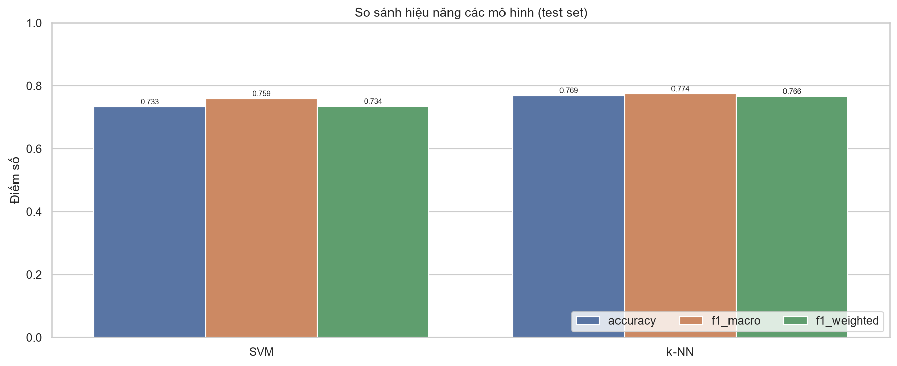
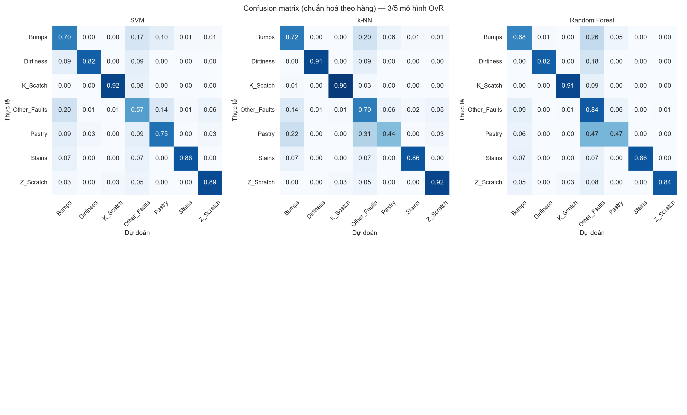

# Phân loại lỗi bề mặt tấm thép

Phân loại **7 loại lỗi bề mặt tấm thép** từ **đặc trưng hình học và độ sáng**, dùng các mô hình học máy cổ điển với chiến lược **One-vs-Rest (OvR)**.

[](https://colab.research.google.com/github/Vehicle666/steel-plate-fault-classification/blob/main/notebooks/01_train_colab.ipynb)

## Thông tin đề tài

| Mục | Nội dung |
|---|---|
| Tên đề tài | Phân loại loại lỗi bề mặt tấm thép từ đặc trưng hình học và độ sáng |
| Mô hình | SVM, k-NN, Random Forest, Extra Trees, Gradient Boosting |
| Chiến lược đa lớp | One-vs-Rest (OvR) |
| Đánh giá | Accuracy, Balanced accuracy, Macro/Weighted F1, Ma trận nhầm lẫn |
| Dataset | [Steel Plates Faults – UCI ML Repository](https://archive.ics.uci.edu/dataset/198/steel+plates+faults) |
| Quy mô | 1.941 mẫu, 27 đặc trưng, 7 lớp lỗi |
| Mức độ | Trung bình |

### Lưu ý về dữ liệu

- Nhãn gốc ở dạng **one-hot 7 cột** → được chuyển về **một nhãn duy nhất** (`idxmax`).
- 7 lớp: `Pastry`, `Z_Scratch`, `K_Scatch`, `Stains`, `Dirtiness`, `Bumps`, `Other_Faults`.
- Lớp **`Other_Faults`** gom nhiều dạng lỗi khác nhau nên rất khó tách → cần phân tích riêng trong confusion matrix.

### Phân bố lớp (đã kiểm tra)

| Lớp | Số mẫu |
|---|---:|
| Other_Faults | 673 |
| Bumps | 402 |
| K_Scatch | 391 |
| Z_Scratch | 190 |
| Pastry | 158 |
| Stains | 72 |
| Dirtiness | 55 |
| **Tổng** | **1.941** |

Dữ liệu sạch: không có giá trị thiếu, mỗi dòng có đúng 1 nhãn one-hot = 1. Tập dữ liệu **mất cân bằng** (lớp lớn nhất gấp ~12 lần lớp nhỏ nhất) nên dùng thêm macro-F1 và balanced accuracy.

## Kết quả (test set 20%, random_state=42)

| Hạng | Mô hình | Accuracy | Balanced acc. | Macro-F1 | Weighted-F1 |
|---:|---|---:|---:|---:|---:|
| 1 | **Gradient Boosting** | **0.7943** | **0.7917** | **0.8114** | **0.7963** |
| 2 | Extra Trees | 0.7892 | 0.7893 | 0.8047 | 0.7887 |
| 3 | Random Forest | 0.7892 | 0.7732 | 0.8015 | 0.7897 |
| 4 | k-NN | 0.7686 | 0.7866 | 0.7741 | 0.7660 |
| 5 | SVM (RBF) | 0.7326 | 0.7882 | 0.7588 | 0.7339 |





Nhận xét nhanh: các mô hình cây (Gradient Boosting, Extra Trees, Random Forest) cho kết quả tốt nhất; `Other_Faults` là lớp bị nhầm nhiều nhất vì bản chất là lớp "gộp", trong khi `Dirtiness` (chỉ 55 mẫu) khó học do thiếu dữ liệu.

## Chạy trên Google Colab (tự push từng bước, không sợ mất runtime)

Bấm badge Colab ở trên, hoặc mở [`notebooks/01_train_colab.ipynb`](notebooks/01_train_colab.ipynb).

**Chuẩn bị 1 lần:** tạo **Fine-grained Personal Access Token** (Settings → Developer settings → Personal access tokens), chọn repo này, cấp quyền **Contents: Read and write**; thêm vào **Colab Secrets** (🔑) với tên `GH_TOKEN` và bật *Notebook access*.

Notebook sẽ:

1. Nạp token từ Colab Secrets (không ghi token vào repo).
2. `git clone` repo từ GitHub.
3. Cài `requirements.txt`.
4. Chạy `python -m src.train --push`: **sau mỗi mô hình** tự commit + push `reports/` và `checkpoints/`.
5. Hiển thị bảng kết quả, confusion matrix; tải `ket_qua.zip` nếu muốn.

### Chống mất tiến độ

- Mỗi mô hình xong → 1 commit: `train: [3/5] Random Forest — acc=0.7892, macro-F1=0.8015`.
- Trạng thái train nằm ở `checkpoints/train_state.json` (config, metrics, dự đoán của từng mô hình đã xong) và **được push lên GitHub**.
- Runtime chết → mở runtime mới, chạy lại mục 1 của notebook rồi chạy:

```powershell
python -m src.train --resume --push
```

Các mô hình đã có trong checkpoint sẽ được **bỏ qua**, chỉ train phần còn thiếu. Nếu đổi `--test-size`/`--random-state` thì checkpoint cũ không khớp cấu hình và sẽ train lại từ đầu (có cảnh báo).

> Lưu ý: `checkpoint` chỉ lưu metrics + nhãn dự đoán (không lưu model nặng), nên kéo về máy rất nhẹ. `models/best_model.joblib` chỉ được tạo khi lần chạy đó có fit ít nhất mô hình tốt nhất.

## Chạy local

```powershell
python -m venv .venv
.\.venv\Scripts\Activate.ps1
pip install -r requirements.txt

python -m src.download_data          # tải lại dataset (đã có sẵn trong repo)
python -m src.train                  # huấn luyện + đánh giá
python -m src.train --resume         # train tiếp từ checkpoint
python -m src.train --push           # tự commit & push sau mỗi mô hình
python -m src.train --test-size 0.3 --random-state 7
```

Kết quả sinh ra:

| Đường dẫn | Nội dung |
|---|---|
| `reports/results.csv`, `results.md` | Bảng điểm các mô hình |
| `reports/classification_report_*.txt` | Precision/Recall/F1 từng lớp |
| `reports/figures/*.png` | Confusion matrix & biểu đồ so sánh |
| `checkpoints/train_state.json` | Trạng thái train để resume (có commit) |
| `models/best_model.joblib` | Pipeline (scaler + model) tốt nhất |

## Cấu trúc project

```
.
├── checkpoints/
│   └── train_state.json              # trạng thái train để --resume
├── data/
│   ├── raw/                          # dataset gốc UCI (có commit, < 1 MB)
│   └── processed/                    # dữ liệu trung gian (không commit)
├── models/                           # mô hình đã huấn luyện (không commit)
├── notebooks/
│   └── 01_train_colab.ipynb          # notebook chạy trên Colab
├── reports/
│   ├── figures/                      # confusion matrix, biểu đồ
│   ├── results.csv / results.md
│   └── classification_report_*.txt
├── src/
│   ├── config.py                     # đường dẫn, hằng số
│   ├── data.py                       # đọc dữ liệu, one-hot → nhãn, chia tập
│   ├── download_data.py              # tải dataset từ UCI
│   ├── git_sync.py                   # commit & push từng bước (Colab)
│   ├── models.py                     # 5 mô hình bọc OvR
│   └── train.py                      # huấn luyện, checkpoint, resume, push
├── requirements.txt
└── README.md
```

## Phương pháp

1. Đọc `Faults.NNA` (tab-separated, không header), gán tên cột từ `Faults27x7_var`.
2. Chuyển 7 cột one-hot → 1 nhãn (`Other_Faults`, `Bumps`, ...).
3. Chuẩn hoá `StandardScaler` (fit trên train, áp dụng cho test) trong `Pipeline`.
4. Chia **stratified 80/20** để giữ tỉ lệ lớp.
5. Mỗi mô hình bọc `OneVsRestClassifier` → 7 bộ phân loại nhị phân.
6. Đánh giá Accuracy, Balanced accuracy, Macro/Weighted F1 và confusion matrix.

## Trạng thái

- [x] Khởi tạo môi trường & cấu trúc project
- [x] Tải và khảo sát dataset
- [x] Tiền xử lý (one-hot → nhãn, chuẩn hoá, chia train/test)
- [x] Huấn luyện 5 mô hình với OvR
- [x] Đánh giá & confusion matrix
- [x] Notebook Colab lấy code từ GitHub
- [x] Checkpoint sau mỗi mô hình + tự push lên GitHub + resume
- [ ] Viết báo cáo chi tiết

## Trích dẫn

> Buscema, M. (2013). Steel Plates Faults [Dataset]. UCI Machine Learning Repository.
> https://doi.org/10.24432/C5J590
